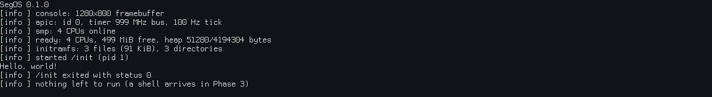
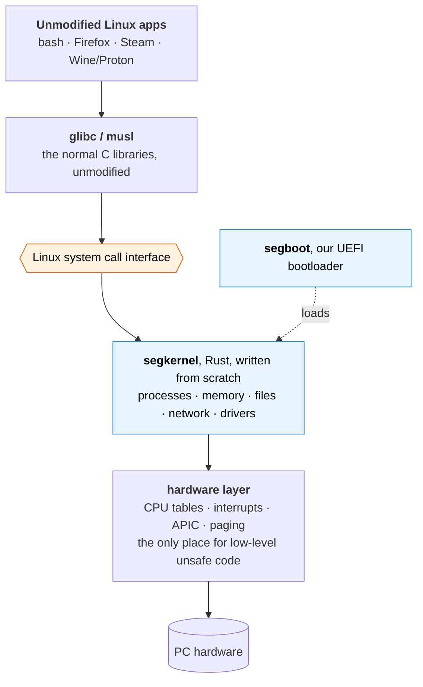
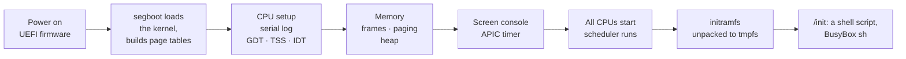
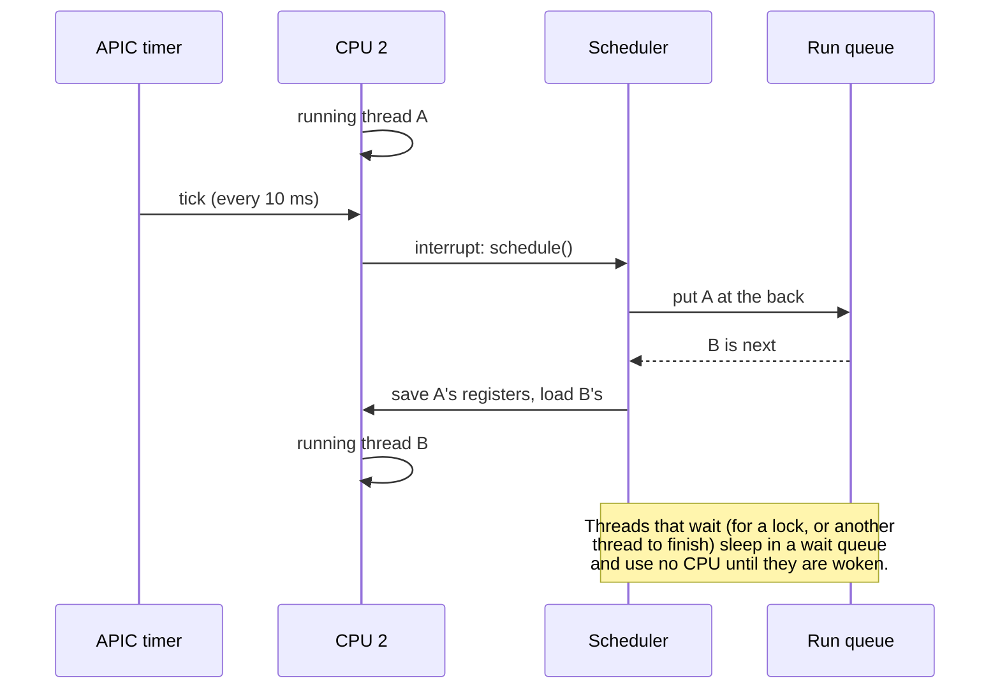
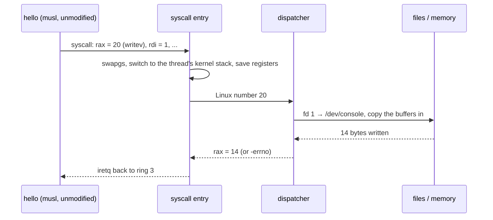
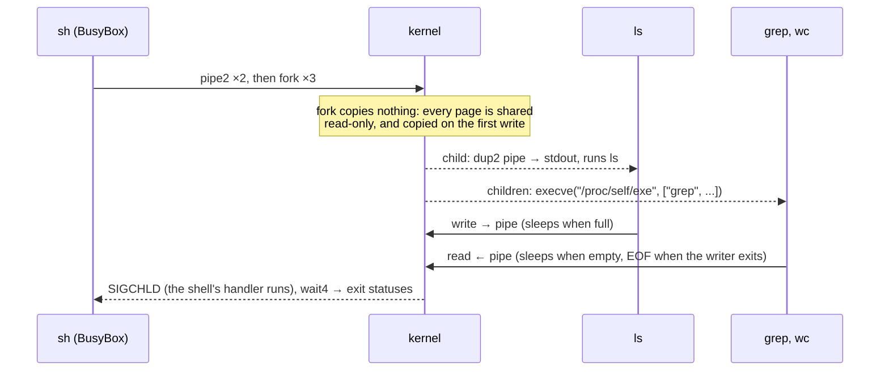
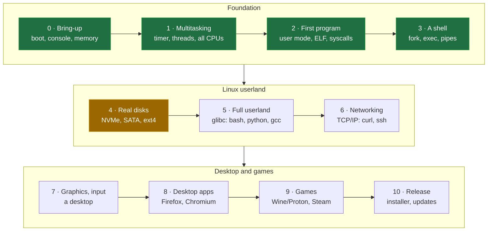

# SegOS

An operating system written from scratch in Rust, aiming to run **unmodified
Linux applications** (and, through Wine/Proton, Windows ones) by implementing
the Linux system call interface in a new kernel.

Status: **Phase 4 (real disks) done**. SegOS boots on UEFI with its own
bootloader, starts every CPU, finds its disks (virtio, NVMe and SATA
drivers), reads their GPT partitions and **boots from an ext4 root file
system on disk**, read-write: what SegOS writes passes Linux's `e2fsck`.
On it runs **a shell**: BusyBox, the statically linked binary exactly as
Ubuntu ships it, with `fork`, signals, pipes, job control and `/proc`
behind it. FAT32 (the EFI partition), `mount`/`umount`, a write-back
block cache and a page cache with real shared file mappings are in too.
Four conformance tests print byte for byte what they print on Linux.
Next is Phase 5: the full Linux userland (glibc, dynamic linking,
threads).

The operating system itself is all in this repository: the bootloader, the
kernel and the build tool use no third-party crates, only Rust's `core`,
`alloc` and (for the build tool) `std`. What runs *on* it is ordinary
Linux software, unmodified: BusyBox from Ubuntu, and test programs in
`userland/` written in C and built with the normal Linux toolchain
(`musl-gcc`), because the point is that SegOS runs what Linux compilers
produce.

The whole roadmap, from here to Steam: [docs/plan.md](docs/plan.md).



*SegOS today, in QEMU: Ubuntu's BusyBox shell on the kernel's framebuffer
console. `ls /bin | grep sh | wc -l` is the Phase 3 demo; `ps` and `free`
read `/proc`; `hello` is a musl program built on Linux.*

## How SegOS works

### The idea: speak Linux, run everything

Steam, Firefox, Discord, Blender and Wine are already built as Linux
programs. Nobody will rewrite them for a new OS, so SegOS does the opposite:
its kernel answers the **same system calls as Linux** (same numbers, same
data structures, same error codes) and provides the same `/proc`, `/sys` and
`/dev` files. A program cannot tell it is not on Linux, so it runs
unmodified. Windows games come along through Wine and Proton, which are
Linux programs themselves.



### What happens when it boots



segboot is a UEFI application (`EFI/BOOT/BOOTX64.EFI` on the disk). It
reads `\boot\segkernel` from the same partition, copies its ELF segments
into memory, builds the kernel's first page tables, picks a framebuffer,
finds the ACPI tables, exits the firmware's boot services and jumps to the
kernel with a [`BootInfo`](bootinfo/src/lib.rs) describing the machine.
The kernel then starts the other CPUs itself, from the ACPI processor list.

Every step logs to the serial port, so if something fails early you still
see how far it got. A crash prints the faulting address, all registers and
a backtrace.

### How it runs many threads at once

Every CPU has a timer that fires 100 times a second. Each tick, the
scheduler may take the CPU from the running thread and give it to the next
one waiting in line. This is preemption: a thread that never stops cannot
freeze the system.



### How a Linux program runs

`/init` is an ordinary static Linux executable. The kernel reads its ELF
headers, creates an address space, maps its segments, and builds the stack
exactly as Linux does (`argc`, `argv`, `envp`, the auxiliary vector), then
drops to ring 3 at its entry point. From there the C library talks to the
kernel only through the `syscall` instruction:



Memory is mapped lazily: the program's regions (code, data, heap, stack,
`mmap`) are recorded, and the first touch of a page faults and gets a
zeroed frame. A touch outside every region is SIGSEGV, as on Linux: the
program's handler runs if it has one, otherwise it dies and the kernel
carries on. Unknown system calls return `ENOSYS` and are logged once,
which is the to-do list for what comes next.

### How the shell runs `ls | grep | wc`



BusyBox is one binary with a symbolic link per command (`/bin/ls →
/bin/busybox`); it runs its own commands by executing `/proc/self/exe`.
Signals are delivered the way Linux does it, down to the byte layout of the
frame built on the program's stack, so the C library's handlers and
`sigreturn` work unchanged; a system call interrupted by a signal is
restarted or fails with EINTR, as SA_RESTART says. The terminal does
Linux's line discipline: editing keys, echo, and `^C`/`^Z` becoming
SIGINT/SIGTSTP for the foreground process group.

### Where things live in memory

| Virtual address | What |
|---|---|
| `0xffff_8000_0000_0000` | all physical memory, mapped directly (set up by segboot) |
| `0xffff_c000_0000_0000` | kernel heap: starts at 4 MiB, grows on demand |
| `0xffff_d800_0000_0000` | kernel thread stacks, 64 KiB each, with an unmapped guard page below |
| `0xffff_e000_0000_0000` | device registers (local APIC) |
| `0xffff_ffff_8000_0000` | the kernel itself |

The lower half (below `0x0000_8000_0000_0000`) belongs to each program,
laid out as on Linux:

| Virtual address | What |
|---|---|
| `0x0000_0000_0040_0000` | a static executable's code and data (`0x5555_5555_4000` for a static PIE) |
| just above it | `brk` heap |
| below `0x0000_7f00_0000_0000` | `mmap` regions, allocated downwards |
| `0x0000_7fff_ff7f_f000`–`0x0000_7fff_ffff_f000` | the main thread's 8 MiB stack |

## The plan

Eleven phases. Each one ends with a demo that has to pass in QEMU and in CI
before the next starts. The goal at the end: install SegOS like any OS, then
install Steam and play.



Green is done, amber is next.

How progress is measured: small test programs whose output is recorded on
real Linux and compared on SegOS (`userland/tests/`, see below); a
published table of which Linux system calls work; and a ladder of real
applications run in CI, from BusyBox up to Steam.

Honest expectation: a working shell within months, a desktop with a browser
in 2 to 3 years, games after that. Drivers for real graphics cards are the
hardest part, as they were for every new OS. The details, phase by phase,
are in [docs/plan.md](docs/plan.md).

## The website

The project site (`site/`, deployed by Vercel) explains the project and
tracks the roadmap.


## Build and run

Needs Rust (the version is pinned in `rust-toolchain.toml`), QEMU, OVMF
(UEFI firmware for QEMU) and musl-gcc (for the Linux test programs). On
Debian/Ubuntu:

```bash
sudo apt install qemu-system-x86 ovmf musl-tools git
```

The first image build also fetches Ubuntu's `busybox-static` package with
`apt-get download` (no root needed) into `target/busybox`. Elsewhere, set
`BUSYBOX` to any statically linked x86-64 busybox.

```bash
cargo xtask run          # build the disk image and boot it in QEMU: a shell
```

```bash
cargo xtask test         # userland tests on Linux, kernel tests, a scripted shell session
```

```bash
cargo xtask image        # target/segos.img
```

`target/segos.img` is a GPT disk with one FAT32 EFI system partition,
written by `xtask` itself: segboot, the kernel and the initramfs (a `newc`
cpio archive of `userland/rootfs`, BusyBox with its applet links, and the
test programs). In QEMU the shell is on the window and on the terminal you
started it from (serial); type `poweroff -f` to turn it off. To boot a
real PC from a USB stick (UEFI only, Secure Boot off; this erases the
stick):

```bash
sudo dd if=target/segos.img of=/dev/sdX bs=4M conv=fsync
```

Set `OVMF=/path/to/OVMF.fd` if your distribution keeps it elsewhere than
`/usr/share/ovmf/OVMF.fd`, and `MUSL_GCC` if musl's compiler has another
name.

### Testing against Linux

Every test in `userland/tests/` (C programs and shell scripts) has a
`.expected` file: its exact output. `cargo xtask test` first runs each one
**on the Linux machine doing the build** (scripts with the same BusyBox)
and fails if Linux does not print exactly that, so the expectations are
Linux's behaviour, not SegOS's. Then it boots SegOS, where the kernel
test suite runs each one again and compares. Finally it boots SegOS
normally, types commands into the shell over the serial port as a user
would, checks what they print, and turns the machine off with
`poweroff -f`.

| Test | What it covers |
|---|---|
| `basics.c` | arguments and auxv, `brk`/`mmap`/`mprotect`, files and directories, time, randomness |
| `process.c` | `fork`, copy-on-write, pipes, `poll`, signal handlers, SA_RESTART, SIGSEGV handlers, stop/continue, `sigsuspend`, `execve`, `vfork`, `posix_spawn`, close-on-exec, process groups |
| `shell.sh` | BusyBox: pipelines, redirection, exit statuses, subshells, jobs, `trap`, links, `chmod`, `find`, here-documents, `/proc` |

To add a C test, write it, run it on Linux, and save its output:

```bash
musl-gcc -static -O2 -o /tmp/t userland/tests/NAME.c && /tmp/t > userland/tests/NAME.expected
```

## Layout

| Path | What |
|---|---|
| `boot/` | segboot, the UEFI bootloader: loads the kernel ELF, page tables, memory map, framebuffer |
| `bootinfo/` | the boot protocol: what segboot hands the kernel |
| `kernel/src/hal/` | x86-64: instructions, serial, GDT/TSS, IDT and the trap path, `syscall` entry, ACPI tables (CPUs, I/O APIC, power off), local APIC and timer, I/O APIC, RTC, per-CPU data, starting CPUs |
| `kernel/src/mm/` | frame allocator with reference counts, page tables, kernel heap allocator, process address spaces with copy-on-write (`vm.rs`) |
| `kernel/src/proc/` | processes: `fork`/`clone`, `execve` (with `#!`), exit and `wait4`, process groups and sessions, signals, the ELF loader, user faults |
| `kernel/src/syscall/` | the Linux system calls, by Linux number |
| `kernel/src/fs/` | the VFS with symbolic links, tmpfs, `/dev` devices, pipes, `/proc`, the initramfs (cpio) unpacker |
| `kernel/src/tty.rs` | the console terminal: line discipline, termios, job control |
| `kernel/src/drivers/` | PS/2 keyboard |
| `kernel/src/abi.rs` | Linux's error numbers, flags and structure layouts |
| `kernel/src/task/` | kernel threads, scheduler and context switch, wait queues |
| `kernel/src/sync.rs` | interrupt-safe spinlock, sleeping mutex |
| `kernel/src/time.rs` | TSC clock, wall-clock time from the RTC, sleeping |
| `kernel/src/console.rs` | framebuffer text console with VT100/ANSI escape sequences |
| `kernel/src/font.rs` | the console's 8×16 bitmap font |
| `kernel/src/klog.rs` | kernel log levels and macros |
| `kernel/src/ktest.rs` | in-kernel tests |
| `xtask/` | build tool: builds segboot, the kernel and `userland/`, writes the initramfs and the GPT/FAT32 disk image, runs QEMU |
| `userland/` | what SegOS runs: `rootfs/` (`/init`, `/etc`), `hello/` (the Phase 2 demo, `/usr/bin/hello`) and `tests/` (conformance tests with their Linux output) |
| `site/` | the website, deployed by Vercel (`vercel.json`) |

Subsystems become their own crates once they grow (see the plan).

## Licence

MIT or Apache-2.0, at your option.

The disk image also contains BusyBox, unmodified, from Ubuntu's
`busybox-static` package (GPL-2.0; its source is Ubuntu's `busybox` source
package, `apt-get source busybox`). It is not part of this repository.

The previous project in this repository, SegLinux (a Linux distribution),
is in the git history up to its 1.0.0 release: commit
[`fededbe`](https://github.com/SegMind25/SegOS/commit/fededbe1b8a5d5d58cc89a27f7e7852b27409f80).
